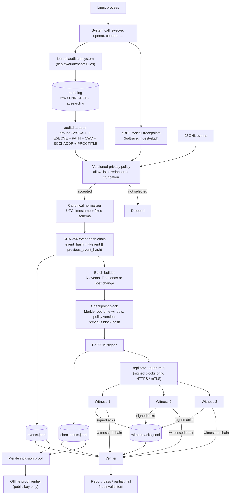

# B-SCAF Architecture and Demo Guide

This guide describes the implemented Blockchain-Based System Call Audit Framework (B-SCAF): its architecture, threat model, and a repeatable demo. Every command runs inside the project container, so the host needs only Docker:

```bash
sudo docker build -t bscaf .
```

```bash
sudo docker run --rm -it -v "$PWD":/app -w /app -p 8000:8000 bscaf bash
```

The commands in sections 5–10 are typed in that container shell.

## 1. Architecture at a glance



## 2. Threat model

**Protected assets.** The integrity, order and origin of committed system-call events. Their availability, through independent witness copies. The confidentiality of argument values, through policy redaction before hashing and through witnesses receiving metadata only.

**Attacker abilities assumed.**

- Root on the source host after collection: they can edit, delete, insert or reorder lines in `events.jsonl`, `checkpoints.jsonl` and `witness-acks.jsonl`.
- They can read the source signing key and re-sign a rewritten history.
- They can take some witnesses offline.

**What B-SCAF guarantees.** Any change to a committed event or block is reported, provided two things hold. First, the verifier trusts the source public key. Second, at least the quorum of witnesses is honest and reachable. Changes that keep every local hash and signature consistent are still caught by comparison with the witnessed chain: re-signing with a stolen key, or deleting the newest blocks. Witnesses refuse conflicting blocks and keep evidence of the attempt.

**What it does not guarantee.**

- A compromised kernel, auditd or collector can fabricate or drop events before collection. This is the capture-trust limit.
- Events not yet in a signed, replicated block can be deleted unnoticed.
- If every witness is compromised, or unreachable, the verdict is `partial`, not `pass`.

## 3. Components

| Component | Source file | Responsibility |
| --- | --- | --- |
| Event model | `src/bscaf/models.py` | Validates fields, canonicalizes timestamps, and computes event and block hashes. |
| Canonical encoding | `src/bscaf/canonical.py` | Deterministic JSON before every SHA-256. |
| Privacy policy | `src/bscaf/policy.py` | Syscall allow-list, key and inline-secret redaction, truncation, policy version. |
| eBPF collector | `src/bscaf/ebpf.py` | Generates the bpftrace program, finds its own kernel PID so it does not trace itself, and turns tracepoint output into events (paths, argv, destinations, return codes). |
| auditd adapter | `src/bscaf/auditd.py` | Parses raw, ENRICHED, `node=` and `ausearch -i` records, merges the records of one event, and maps syscall numbers per architecture. |
| Evidence store | `src/bscaf/store.py` | Append-only JSONL ledgers, fsync per block, writer lock. |
| Merkle and signatures | `src/bscaf/merkle.py`, `crypto.py` | Batch roots, inclusion proofs, Ed25519. |
| Audit service | `src/bscaf/service.py` | Ingest with cached tail state, batching, signing, single-pass verification, proofs. |
| Witnesses | `src/bscaf/witness.py` | Chain-continuity checks, equivocation records, signed acks, quorum replication, witness comparison. |
| TLS | `src/bscaf/tlsutil.py` | Development PKI and the server/client contexts for HTTPS and mutual TLS. |
| Attack scenarios | `src/bscaf/attacks.py` | The brief's tampering tests, reusable on any store. |
| Benchmark | `src/bscaf/bench.py` | Phase 6 comparison of plain logging, hash chain and B-SCAF. |
| CLI and dashboard | `src/bscaf/cli.py`, `ui.py` | Operational commands and the local web view. |

## 4. Evidence lifecycle

1. The eBPF collector emits one record per completed system call. Alternatively, auditd writes several records per kernel event. The adapter groups them by `audit(<time>:<serial>)`, emits one event with argv, paths, cwd and destination, and drops raw register values.
2. The policy selects relevant calls and redacts secrets. Its version is recorded in each block.
3. Each event is hashed together with the previous event hash and appended to `events.jsonl`.
4. A block closes after N events, after T seconds of event time, or when the host changes. The Merkle root, sequence range, time window, policy version and previous block hash are signed with Ed25519. Events are fsynced before their block.
5. `replicate` sends signed blocks, never events, to the witnesses and stores their signed acknowledgements.
6. `verify` checks the chain, roots, links, ranges, replay and signatures. With `--witness`, it also compares against each witness copy and checks acks.

## 5. Demo: create and verify a ledger

```bash
bscaf --data-dir demo --batch-size 2 demo
```

This ingests three events, commits two blocks and prints the report:

```json
{
  "valid": true,
  "verdict": "pass",
  "events_checked": 3,
  "checkpoints_checked": 2,
  "first_problem": null,
  "problems": [],
  "warnings": []
}
```

## 6. Demo: export and independently verify one event

```bash
bscaf --data-dir demo proof --sequence 1 > demo/proof.json
bscaf proof-verify --input demo/proof.json --public-key demo/signing-public.pem
```

```json
{
  "valid": true,
  "sequence": 1,
  "block_number": 1,
  "problems": []
}
```

## 7. Demo: ingest real auditd data

```bash
python scripts/fetch_datasets.py
bscaf --data-dir real --all-syscalls ingest-auditd --input datasets/raw/splunk-attack-data-auditd/datasets/attack_techniques/T1068/linux_auditd_copy_fail/linux_auditd.log --host-id lab-1
bscaf --data-dir real flush
bscaf --data-dir real verify
```

The ingest report lists:

- the accepted events and the events ignored by policy;
- rejected records, by reason;
- duplicate records merged;
- records that arrived without their SYSCALL record;
- unresolved user names;
- unmapped system calls.

Running the same `ingest-auditd` command again reports every record under `duplicates_skipped`.

## 8. Demo: witness quorum and tampering

Start three witnesses in the background, then replicate with quorum 2:

```bash
for i in 1 2 3; do
  bscaf witness-init --witness-dir w$i --witness-id witness-$i
  bscaf witness-trust --witness-dir w$i --trusted-signer-id local-witness --public-key real/signing-public.pem
  bscaf witness-serve --witness-dir w$i --port 808$i &
done
bscaf --data-dir real replicate --url http://127.0.0.1:8081 --url http://127.0.0.1:8082 --url http://127.0.0.1:8083 --quorum 2
```

Verify against the witnesses:

```bash
W="--witness http://127.0.0.1:8081 --witness http://127.0.0.1:8082 --witness http://127.0.0.1:8083 --witness-key witness-1=w1/witness-public.pem --witness-key witness-2=w2/witness-public.pem --witness-key witness-3=w3/witness-public.pem --quorum 2"
bscaf --data-dir real verify $W
```

Now act as an attacker with root on the source. Delete the newest block and its events:

```bash
sed -i '$d' real/checkpoints.jsonl
python - <<'EOF'
import json
last = max(json.loads(l)["last_sequence"] for l in open("real/checkpoints.jsonl"))
lines = [l for l in open("real/events.jsonl") if json.loads(l)["sequence"] <= last]
open("real/events.jsonl", "w").writelines(lines)
EOF
bscaf --data-dir real verify
bscaf --data-dir real verify $W
```

Local verification still says `pass`, because every remaining hash and signature is consistent. Verification against the witnesses says `fail` with a `truncation` problem. Stopping one witness (`kill %1`) leaves the verdict at `pass` with a `witness-unavailable` notice. Stopping two makes it `partial`.

To run every scenario automatically (modify, delete, insert, reorder, root change, replay, truncation, rewrite-and-re-sign with the stolen key, forged ack, witness offline, quorum lost) on any store:

```bash
python scripts/attack_matrix.py --data-dir real
```

## 9. Live capture with eBPF

The live image adds bpftrace and must run privileged. It traces the whole host kernel; nothing is installed on the host.

```bash
sudo docker build -t bscaf-live -f deploy/live/Dockerfile deploy/live
sudo docker run --rm -it --privileged --pid=host -v "$PWD":/app -w /app bscaf-live bash
```

Inside that container:

```bash
mount -t tracefs nodev /sys/kernel/tracing
bscaf --data-dir live --batch-seconds 1 ingest-ebpf --host-id my-host --duration 20 &
sleep 5; ls -la /etc > /dev/null; python3 -c "import socket; socket.create_connection(('1.1.1.1', 443), timeout=2)"
wait
bscaf --data-dir live search --syscall connect --newest --limit 3
bscaf --data-dir live verify
```

To measure overhead and completeness with a repeatable workload, and to run the attack matrix on the live ledger, run `python scripts/live_capture.py` in the same container. It writes `results/LIVE_REPORT.md`.

Two details matter inside a container:

- The collector's PID inside the container differs from the kernel PID that eBPF reports. `ingest-ebpf` therefore learns its own kernel PID with a one-shot probe, so it never records its own file I/O.
- Docker Desktop containers cannot reach the kernel's audit control interface: the kernel accepts audit commands only from the initial PID namespace. auditd therefore needs a real Linux host or VM. The eBPF collector has no such restriction.

## 10. Full real-data validation and benchmarks

```bash
python scripts/run_real_data.py
```

This writes `results/REAL_DATA_REPORT.md` and `results/real-data-summary.json`, covering:

- dataset provenance;
- before/after comparison;
- ingestion statistics;
- syscall distribution;
- verification;
- proofs;
- the witness quorum;
- the attack matrix;
- the Phase 6 performance table (100,000 replayed events).

To run the benchmark on its own: `bscaf bench --events 100000 --fsync`.

## 11. Search, TLS and key protection

```bash
bscaf --data-dir real search --syscall bind --text python --newest --limit 3
bscaf tls-certs --out pki --host 127.0.0.1
bscaf witness-serve --witness-dir w1 --port 8443 --tls-cert pki/server.pem --tls-key pki/server-key.pem --client-ca pki/ca.pem &
bscaf --data-dir real --ca-file pki/ca.pem --client-cert pki/client.pem --client-key pki/client-key.pem replicate --url https://127.0.0.1:8443
export BSCAF_KEY_PASSPHRASE='long passphrase'   # encrypts keys created from now on
```

A client without a certificate from the CA is refused at the TLS handshake. With `--replicate-url`, `ingest-ebpf` and `ingest-auditd --follow` push each block as soon as it is signed.

## 12. Dashboard

```bash
bscaf --data-dir ui-demo --batch-size 2 ui --host 0.0.0.0 --no-browser
```

Open `http://127.0.0.1:8000` on the host. **Add demo events** commits a three-event trail. **Verify integrity** reruns every check and shows `INTEGRITY VALID`, `PARTIAL EVIDENCE` or `INTEGRITY FAILED`, together with the policy version, problems and warnings.

## 13. Tests

```bash
pytest -q
```

The suite covers:

- integrity and tampering;
- real-data parser fixtures, including every log format;
- the CLI, including re-ingest de-duplication;
- the full attack matrix against three HTTP witnesses;
- witness chain rules;
- the benchmark harness;
- the eBPF parser and capture loop (with recorded tracer output);
- search, encrypted keys, mutual TLS, and replication on commit.

## 14. Limits and future work

See [`REMAINING_WORK.md`](REMAINING_WORK.md). The main items are hardware-backed key storage, an indexed store for very large ledgers, and an auditd run on a full Linux VM.
