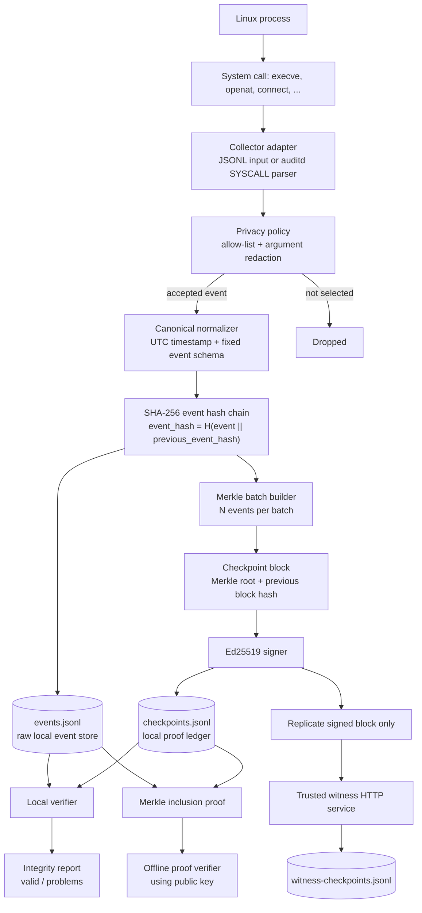

# B-SCAF Architecture and Demo Guide

This guide describes the implemented MVP of the Blockchain-Based System Call Audit Framework (B-SCAF) and provides a repeatable PowerShell demo.

## 1. Architecture at a glance



## 2. Components and responsibilities

| Component | Source file | Responsibility |
| --- | --- | --- |
| Event model | `src/bscaf/models.py` | Validates required fields, canonicalizes timestamps, and calculates event/block hashes. |
| Canonical encoding | `src/bscaf/canonical.py` | Produces deterministic JSON before SHA-256 calculations. |
| Privacy policy | `src/bscaf/policy.py` | Keeps only security-relevant system calls and redacts sensitive arguments such as `token`, `password`, and `secret`. |
| Auditd adapter | `src/bscaf/auditd.py` | Translates Linux `type=SYSCALL` records into the B-SCAF event schema. |
| Evidence store | `src/bscaf/store.py` | Maintains newline-delimited raw events and signed checkpoint blocks. |
| Merkle module | `src/bscaf/merkle.py` | Builds batch roots and membership proofs. |
| Signature module | `src/bscaf/crypto.py` | Creates and verifies Ed25519 checkpoint signatures. |
| Audit service | `src/bscaf/service.py` | Orchestrates ingest, batching, checkpoint creation, local validation, and proof export. |
| Witness service | `src/bscaf/witness.py` | Retains validated signed checkpoint metadata on an independent node. |
| CLI | `src/bscaf/cli.py` | Provides the operational commands used below. |

## 3. Evidence lifecycle

1. A collector produces a JSON event or an auditd adapter parses a `SYSCALL` record.
2. The policy allow-list selects relevant calls and redacts sensitive argument values.
3. B-SCAF normalizes the event and computes its SHA-256 hash, including the preceding event hash.
4. Events are persisted locally and grouped into batches. A Merkle root commits every event hash in that batch.
5. B-SCAF creates a checkpoint containing the root, batch range, previous block hash, signer identity, and timestamp. The checkpoint is Ed25519-signed.
6. The signed block can be replicated to a configured witness. No raw event data is sent to the witness.
7. An auditor can validate the complete local store or validate one event's exported Merkle proof offline.

## 4. Data retained at each layer

| Layer | Stored data | Purpose |
| --- | --- | --- |
| Local event store | Normalized event attributes, previous event hash, event hash | Forensic search and chain verification. |
| Local checkpoint ledger | Batch boundaries, Merkle root, block link, signature | Compact immutable commitment for each event batch. |
| Witness ledger | Signed checkpoint block only | Independent proof of commitment without exposing raw system-call records. |

## 5. Prerequisites

Run the commands from `D:\projects\os_block`. The commands below use the bundled Python runtime available in this Codex environment.

```powershell
$env:PYTHONPATH = "src"
$py = "C:\Users\adity\.cache\codex-runtimes\codex-primary-runtime\dependencies\python\python.exe"
```

For a standalone setup, install the project dependencies from `pyproject.toml` and use any Python 3.11+ runtime with `cryptography` installed.

## 6. Demo: create and verify an audit ledger

Run the built-in demo with a batch size of two. It creates three events, commits two checkpoint blocks, and validates the ledger.

```powershell
& $py -m bscaf.cli --data-dir .\audit-data-demo --batch-size 2 demo
```

Observed output from this workspace:

```json
{
  "valid": true,
  "events_checked": 3,
  "checkpoints_checked": 2,
  "problems": []
}
```

Check the current status at any time:

```powershell
& $py -m bscaf.cli --data-dir .\audit-data-demo status
```

Observed output:

```json
{
  "data_dir": "audit-data-demo",
  "valid": true,
  "events_checked": 3,
  "checkpoints_checked": 2,
  "problems": []
}
```

## 7. Demo: export and independently verify one event

Export a Merkle inclusion proof for event sequence 1 and verify it with only the proof and the trusted public key.

```powershell
& $py -m bscaf.cli --data-dir .\audit-data-demo proof --sequence 1 |
    Out-File -Encoding utf8 .\audit-data-demo\proof.json

& $py -m bscaf.cli --data-dir .\audit-data-demo proof-verify `
    --input .\audit-data-demo\proof.json `
    --public-key .\audit-data-demo\signing-public.pem
```

Observed output:

```json
{
  "valid": true,
  "sequence": 1,
  "block_number": 1,
  "problems": []
}
```

## 8. Demo: ingest supplied JSONL or auditd input

The repository includes sample data under `samples/`.

```powershell
# New, clean audit store for this example
& $py -m bscaf.cli --data-dir .\audit-data-input init
& $py -m bscaf.cli --data-dir .\audit-data-input ingest --input .\samples\events.jsonl
& $py -m bscaf.cli --data-dir .\audit-data-input flush
& $py -m bscaf.cli --data-dir .\audit-data-input verify
```

The sample `connect` event contains a `token` field. The policy stores it as `[REDACTED]` before hashing and persistence.

To parse one raw Linux auditd syscall record:

```powershell
& $py -m bscaf.cli --data-dir .\audit-data-input ingest-auditd `
    --input .\samples\auditd-syscall.log --host-id lab-host
& $py -m bscaf.cli --data-dir .\audit-data-input flush
```

## 9. Demo: independent witness replication

Use two PowerShell terminals. On the witness terminal, configure the source public key and start the service:

```powershell
$env:PYTHONPATH = "src"
$py = "C:\Users\adity\.cache\codex-runtimes\codex-primary-runtime\dependencies\python\python.exe"

& $py -m bscaf.cli witness-trust `
    --witness-dir .\witness-data `
    --trusted-signer-id local-witness `
    --public-key .\audit-data-demo\signing-public.pem

& $py -m bscaf.cli witness-serve --witness-dir .\witness-data --host 127.0.0.1 --port 8080
```

On the source terminal, replicate the two signed checkpoint blocks:

```powershell
& $py -m bscaf.cli --data-dir .\audit-data-demo replicate --url http://127.0.0.1:8080
```

Expected response shape:

```json
{
  "replicated": 2,
  "results": [
    {"accepted": true, "duplicate": false, "block_hash": "..."},
    {"accepted": true, "duplicate": false, "block_hash": "..."}
  ]
}
```

Re-running the same command is safe: the witness returns `duplicate: true` for blocks it already retains.

## 10. Tamper-detection demonstration

The verification logic detects a changed event, a broken event link, a changed Merkle root, a modified checkpoint, an invalid signature, and missing/reordered events. The automated test suite exercises clean validation, tampering, Merkle proofs, policy handling, auditd conversion, witness acceptance, and offline proof verification.

```powershell
& $py -m unittest discover -s tests -v
```

Observed result on 11 September 2026:

```text
Ran 8 tests in 0.065s

OK
```

## 11. Security boundaries and future work

B-SCAF detects post-commit modification when its checkpoint ledger and trusted public keys remain available. It does not prove that a fully compromised operating-system kernel did not fabricate events before collection.

For production deployment, add an eBPF-based collector, protected private-key storage (TPM/HSM), TLS and mutual authentication for witness communication, durable remote witness quorum rules, log rotation, role-based access control, and a searchable dashboard.
